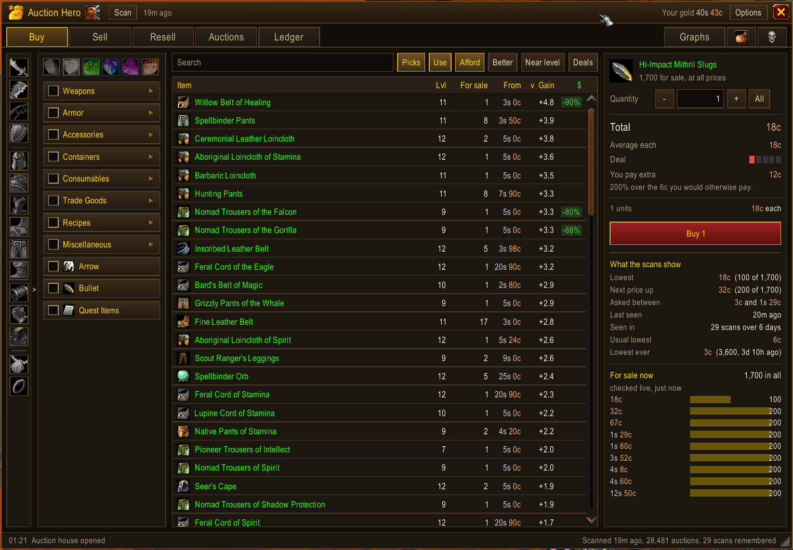
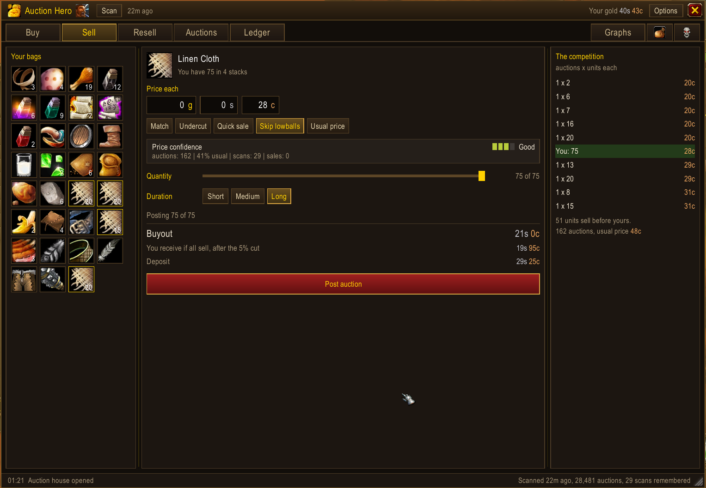
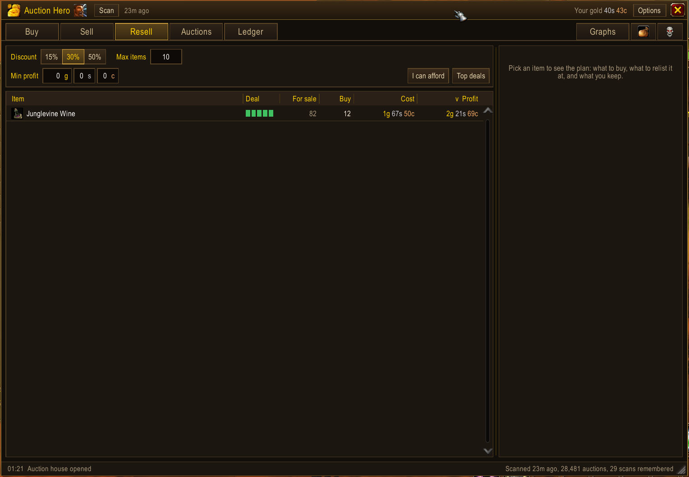
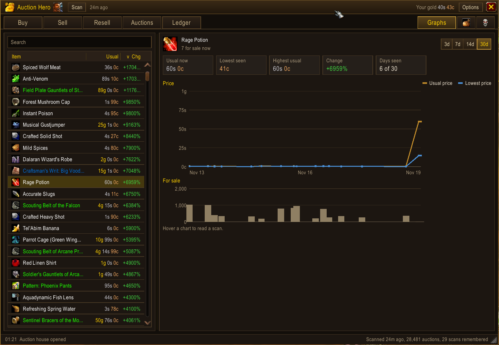
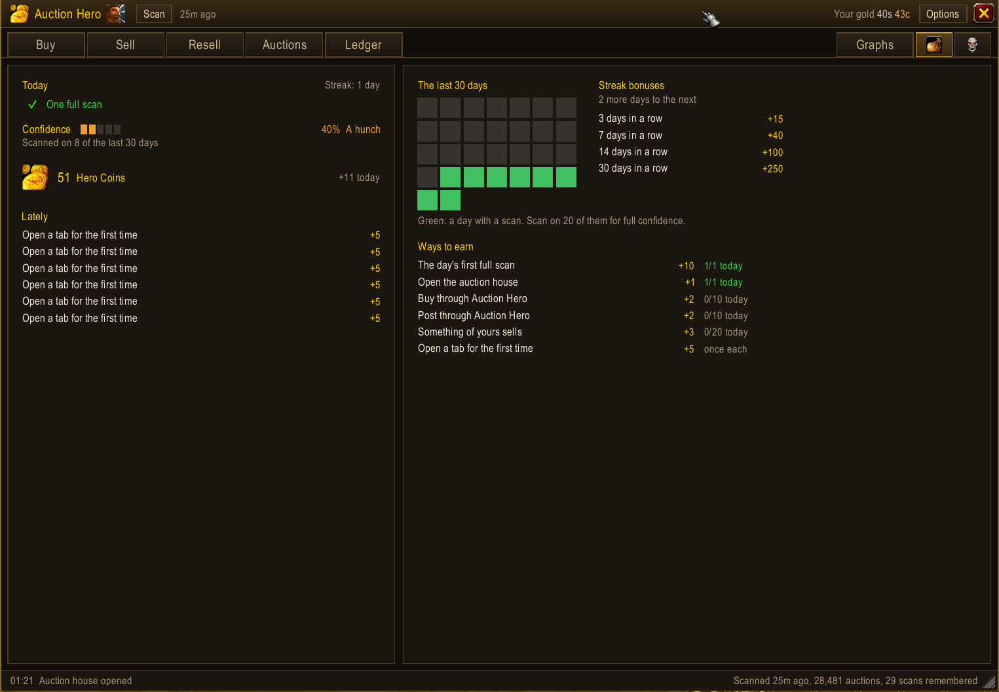

# Auction Hero

**One of the easiest Auction House addons you have ever used!** An early
access work in progress for **World of Warcraft: Forever**.

Auction Hero replaces the stock auction house window with one built for
buying, selling and reselling. Everything it shows comes from your own scans.
There is no outside price feed and nothing to set up: open the auction house,
press **Scan**, and go.

## Buy

A fresh filter layout built around finding better gear. Pick a slot, toggle
**Better** for anything that beats what you wear (stats weighted for your
class) or **Picks** for upgrades you can wear today, sorted by how much they
gain. A deal meter shows how each price compares with what the item usually
goes for.



## Sell

See at a glance how competitive your price is. Your auction is slotted into
the ladder of current listings, so you know where it lands before you post.
Pick from your bags, choose a price rule (match, undercut, quick sale and
more), and see how sure the going rate is.



## Resell

Small markets you could buy out and relist at a profit.



## Graphs

Usual and lowest price as lines and units for sale as bars, over 3, 7, 14 or
30 days.



## Progress and Hero Coins

Scan confidence, a daily scan streak, and Hero Coins earned just by using the
addon. Can you spend them? ...TBD



## And more

- **Auctions:** what you have up for sale, with cancelling in two presses.
- **Ledger:** every auction house trade your character makes and what each
  item has made you.
- **Tooltips:** going rate, lowest price and supply on any item; crafted
  price, material cost and margin on profession recipes.

Open it with `/ah`, or it opens with the auction house. `/ah help` lists the
commands.

## Early access

- Scanning, price history, posting, cancelling and buying goods sold by the
  unit work.
- Buying single items (gear) and buying straight from the Resell tab are
  still being built.
- The server will not take a single item posted for less than 1 silver (it
  hangs the auction house instead of refusing). Auction Hero will not send one.

Found a bug or have an idea? Please open an issue. Screenshots help a lot.

## Install

Install from CurseForge, or copy the `AuctionHero` folder from a
[release](https://github.com/codelab-chaos/auction-hero/releases) ZIP into
`World of Warcraft/_forever_/Interface/AddOns`, then start the game.

## Development

```sh
cd tests && npm install && npm test   # addon tests, against a mocked game client
scripts/deploy.sh                     # copy the addon into your game
python3 scripts/package.py            # build a ZIP into dist/
```

| Folder | What it is |
| --- | --- |
| `AuctionHero/` | The addon |
| `tests/` | Tests, run against a mocked game client |
| `docs/` | How the window is put together ([addon-ui.md](docs/addon-ui.md)), research notes, [builds and releases](docs/releasing.md) |
| `curse-forge/` | The CurseForge description and Media tab entries |

ahero-lab, a local web workbench for studying scans and designing the window,
lives in its own repository beside this one (`../ahero-lab`). The addon does
not depend on it.

## License

MIT. See [LICENSE](LICENSE).
